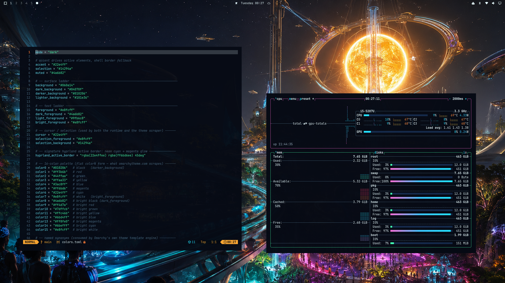

# CyberPhunk

> _the fook is in the machine_
> _that's P-Funk in the machine. that's funkadelic, baby._

<p align="center">
  
</p>

It's 2077 on your desktop, and the neon is the new black. The Mothership glow meets a funky James Brown "Cold Sweat" groove run through a synthesizer. We don't get it — we *got* it.

CyberPhunk is a desktop theme for [Omarchy](https://omarchy.org): a shared cyan, pink and amber palette, neon Hyprland borders, matching icons and cosmic-funk wallpapers. The root `colors.toml` is the palette source; Omarchy applies it across the desktop, terminals, editors, bar and lock screen.

**[](https://omarchytheme.com)**
[](LICENSE)

## Desktop preview



## The palette

One hex, the whole rig. The signature is **cyan `#22e4ff` → magenta `#ff6bd6`** on the active border:

| | | | | | | |
|:---:|:---:|:---:|:---:|:---:|:---:|:---:|
|  |  |  |  |  |  |  |
| `#22e4ff` | `#ff6bd6` | `#ff7a33` | `#44ffaa` | `#3ac8ff` | `#ff3b6b` | `#e8fcff` |

All sixteen colors live in `colors.toml`.

## Install

Open the Omarchy menu with **Super + Space**, choose **Install → Style → Theme**, and paste this repository's GitHub URL. Then select CyberPhunk from the theme menu.

```text
https://github.com/derejealemu/omarchy-cyberphunk-theme
```

## What's included

- `colors.toml` — the desktop palette.
- `hyprland.conf` — the neon cyan-to-magenta active-window border.
- `backgrounds/*.webp` — four cosmic-funk wallpapers.
- `preview.png`, `preview-unlock.png`, `unlock.png` — theme and unlock artwork.
- `icons.theme` — the icon-set preference.
- `lazygit.yml` — an optional matching lazygit palette.

## Uninstall

Select the theme you used before in Omarchy, then remove CyberPhunk's theme directory:

```sh
rm -rf ~/.config/omarchy/themes/cyberphunk
```

## Repo layout

```
colors.toml              # desktop palette
hyprland.conf            # active-window border
backgrounds/*.webp       # compressed wallpapers
preview.png              # theme preview
preview-unlock.png       # unlock preview
unlock.png               # unlock artwork
icons.theme              # icon-set preference
lazygit.yml              # optional lazygit palette
README.md  LICENSE  AGENTS.md
```

## Develop

Edit the theme files and preview them with Omarchy's theme menu. Keep the gallery screenshot current when the desktop's appearance changes.

## License

MIT — see `LICENSE`.
